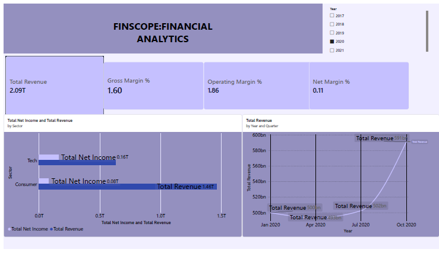
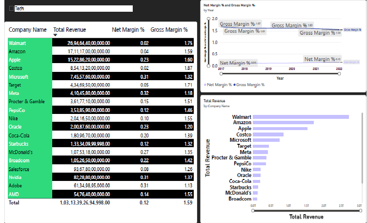
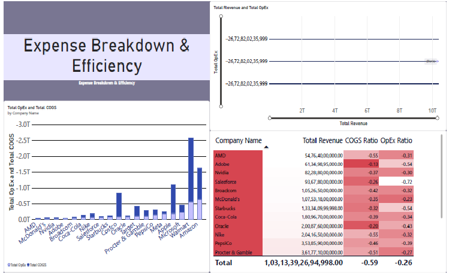
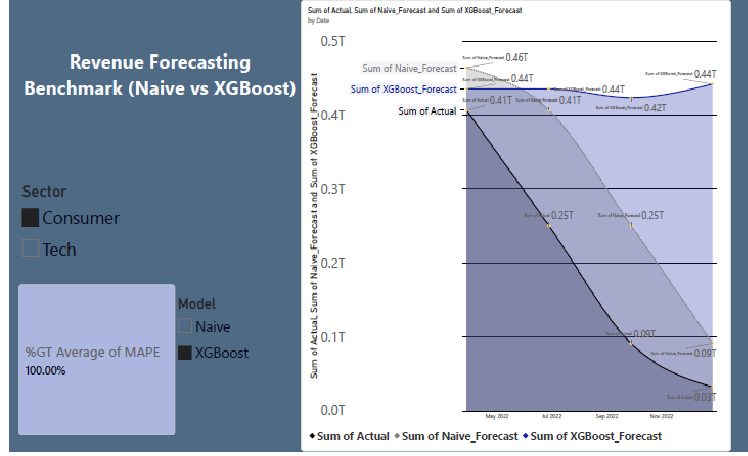
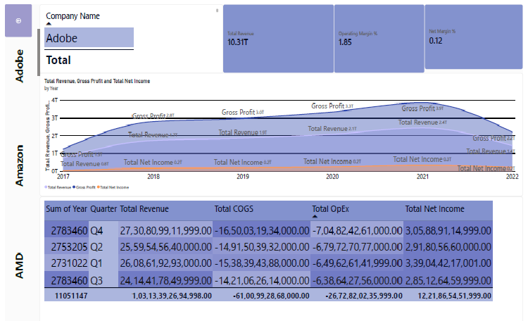

# 📊 FinScope: Multi-Company Financial Analytics & Forecasting
 🎥 **[Watch the 2-Minute Interactive Dashboard Demo Here](https://drive.google.com/file/d/1lLEpUNvnNy3fToy7BRl_Hj9sOqIP40iy/view)
An end-to-end financial analytics platform built in **Power BI, Python, and DAX**. FinScope analyzes 20 public companies across Tech and Consumer sectors, benchmarking their margins and forecasting next-quarter revenue.

## 🎯 The Business Problem
How do we benchmark financial performance across companies and predict which sectors are growing or shrinking? 

## 🖼️ Dashboard Preview

### 1. Executive Summary

### 2. Revenue & Margin Analysis

### 3. Expense Breakdown

### 4. Revenue Forecasting (Naive vs XGBoost)

### 5. Company Detail (Drill-Through)

## 🛠️ Tech Stack
- **Data:** Kaggle (US Market Dataset)
- **Analytics & ML:** Python (Pandas, XGBoost, Scikit-learn)
- **Visualization:** Power BI (DAX, Star Schema, Drill-through)

## 🧠 Methodology
1. **ETL in Power Query:** Cleaned the dataset, filtered for 20 specific tickers, and removed Full Year (FY) data to prevent double-counting.
2. **Star Schema:** Built a relational model (`fact_financials` connected to `dim_company` and `dim_date`).
3. **DAX Measures:** Created custom measures for Gross Margin, Operating Margin, and Net Margin using `DIVIDE`.
4. **Forecasting Benchmark:** Trained an XGBoost regressor and a Naive baseline using a strict time-based split (train on historical, test on last 4 quarters).

## 📈 Key Insights
- **Tech vs Consumer:** Tech companies maintain significantly higher gross margins (~60-80%) compared to Consumer companies (~20-40%).
- **Forecast Accuracy:** XGBoost outperformed the Naive baseline in the Tech sector, proving that machine learning captures growth trends better than simple lag features.

## 🚀 How to Run
1. Clone this repo.
2. Open `FinScope_Dashboard.pbix` in Power BI Desktop.
3. Refresh the data sources (ensure the CSVs are in the same directory).

## ⚠️ Limitations
- The dataset lacks intraday data and is limited to the 20 manually selected tickers.
- Financial data reported in different currencies was not normalized to USD in this version.